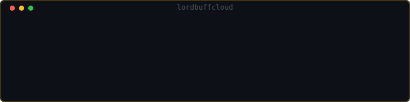

<p align="center">
  
</p>

<h1 align="center">CRIS KING · CK42X</h1>

<p align="center">
  offensive security tooling · firmware · agentic systems<br/>
  20 years U.S. Air Force Security Forces. Retired, building in the open.<br/>
  <em>gold on black. sting once.</em>
</p>

<p align="center">
  
</p>

<p align="center">
  <a href="https://ck42x.com">
    
  </a>
  <a href="https://ck42x.com/blog">
    
  </a>
  <a href="https://github.com/lordbuffcloud">
    
  </a>
  <a href="https://komarev.com/ghpvc/?username=lordbuffcloud&style=flat-square&color=C99A2E">
    
  </a>
</p>

---

## the hive

I build hardware-native offensive tools, OSINT workbenches, and the agentic systems that run them. Flipper Zero, ESP32, LilyGO: if it has a radio or a USB port, it's probably on my bench. Two decades of Air Force Security Forces turned into a software engineering habit, and this account is the proof-of-work ledger. If it's public here, it ran somewhere first.

Everything here is for authorized testing, research, and education. Sting once, with permission.

## right now

- **[FlashBay](https://flashbay.ck42x.com)**: firmware aggregator and browser flasher for security hardware. 75 devices, 153 firmware entries, 82 flashable straight from the browser.
- **nyan ecosystem**: [nyanBEE](https://ck42x.com/nyanbee) ESP32 firmware for Wi-Fi, BLE, and NRF24 workflows, plus [nyanCOMP](https://github.com/lordbuffcloud/nyanCOMP), the FCC-compliant nyanBOX build.
- **Flipper Zero field tools**: [PassVault](https://github.com/lordbuffcloud/flipper-ck42x-passvault), [wakeup](https://github.com/lordbuffcloud/flipper-ck42x-wakeup), [payload-bay](https://github.com/lordbuffcloud/flipper-ck42x-payload-bay), and [stingBEE](https://github.com/lordbuffcloud/stingBEE) (BadUSB research on the LilyGO T-Dongle C5).
- **audit + OSINT**: [StingerSearch](https://ck42x.com/tools/stingersearch) (200+ dork templates, visual query builder) and [HoneyCrack](https://github.com/lordbuffcloud/honeycrack) (self-hosted Hashcat UI).
- **agentic systems**: [VoiceRefine](https://github.com/lordbuffcloud/VoiceRefine) (voice-to-clipboard MCP server for coding agents) and the handstyle campaign, a daily swarm of free models rewriting these repos into my own code fingerprint. The caterpillars are being pinned.
- **audio for the hive**: [Bee Neural Beats](https://bee-neural-beats.vercel.app), [Synchra](https://synchra-peach.vercel.app), [BeeMusic](https://ck42x.com/beemusic). Binaural beats and focus audio.

## arsenal

| Project | What it does | Stack |
|---|---|---|
| [**FlashBay**](https://github.com/lordbuffcloud/flashbay) | Firmware aggregator for security hardware with WebUSB/WebSerial flashing and an operator console. | `TypeScript` `Expo` `WebUSB` `WebSerial` |
| [**nyanCOMP**](https://github.com/lordbuffcloud/nyanCOMP) | FCC-compliant nyanBOX firmware. SigKill removed, because marketing jamming devices violates 47 CFR § 2.803. | `C++` `ESP32` `FCC Part 15` |
| [**CK42X PassVault**](https://github.com/lordbuffcloud/flipper-ck42x-passvault) | Flipper Zero field password vault with memorable generation and opt-in HID typing. | `C` `Flipper Zero` `uFBT` |
| [**stingBEE**](https://github.com/lordbuffcloud/stingBEE) | BadUSB keystroke-injection firmware for LilyGO T-Dongle C5. | `C++` `T-Dongle C5` `BadUSB` |
| [**StingerSearch**](https://github.com/lordbuffcloud/stingersearch) | Bee-themed OSINT and Google dorking interface with 200+ templates and a visual query builder. | `HTML` `OSINT` `Search` |
| [**HoneyCrack**](https://github.com/lordbuffcloud/honeycrack) | Bee-themed self-hosted Hashcat web UI for authorized password audits. | `JavaScript` `Hashcat` `Security` |
| [**VoiceRefine**](https://github.com/lordbuffcloud/VoiceRefine) | Voice-to-clipboard with AI polish. MCP server for Claude Code, Gemini CLI, Codex CLI. | `Python` `MCP` `CLI` |
| [**DopeFlipper**](https://github.com/lordbuffcloud/bruce-dopeflipper) | DopeWars-style game for Bruce firmware on LilyGO T-Embed. | `JavaScript` `Bruce` `LilyGO` |
| [**Bowlytics**](https://github.com/lordbuffcloud/bowlytics-app) | Bowling analytics with AI-powered coaching and data-driven performance tracking. | `HTML` `Analytics` `AI coaching` |

## proof of work (while serving)

Internal tools built and deployed for Department of Defense operations during 20 years in uniform. None are public repos. All were real production software used by real teams.

| Tool | What it solves |
|---|---|
| **StatusBoard** | Integrated ops dashboard. Readiness, scheduling, and AI chat in one view. |
| **WANG** | Award nomination workflow. Timelines, board assignments, scoring. |
| **SF-SCHEDULE** | Shift rotation and personnel scheduling matrix. |
| **EC-QC** | Adaptive quiz platform with spaced repetition and leaderboards. |
| **Data Turnaround** | Entry/exit logging with pattern analytics and visualization. |
| **RAM Tracker** | Resource allocation and monthly distribution management. |
| **GenAI Proxy** | Local AI integration layer for SharePoint applications. |
| **SharePoint Migration** | Cross-site content migration with permission handling. |

TypeScript, Next.js, Python, SharePoint. Shipped for operational teams, not for a portfolio.

## stack


## the ledger

<p align="center">
  
  
</p>

## how i work

- **Structure beats motivation.** Systems that function when willpower doesn't.
- **Automation beats repetition.** If I do it twice, it becomes a script.
- **Evidence beats vibes.** Measure, log, iterate.
- **Style is identity.** Code has a fingerprint whether you choose it or not. I choose mine.

```yaml
identity:
  name: Cris King
  handle: lordbuffcloud
  location: Ohio, USA
  background: 20-year USAF retiree, Security Forces to software engineering
  status: building civilian proof-of-work under CK42X

building:
  - FlashBay (75 devices, browser flashing)
  - nyanBEE / nyanCOMP (ESP32 and nyanBOX firmware)
  - CK42X PassVault (Flipper Zero field vault)
  - stingBEE (T-Dongle C5 BadUSB research)
  - StingerSearch (OSINT workbench)
  - VoiceRefine (voice to clipboard, MCP)
  - the handstyle campaign (swarm-driven code fingerprint)

interests:
  - agentic AI systems
  - authorized security research
  - firmware and hardware hacking
  - graffiti art
  - esoteric study
```

<p align="center">
  ⬡ <a href="https://ck42x.com">ck42x.com</a> · gold on black. sting once.
</p>
